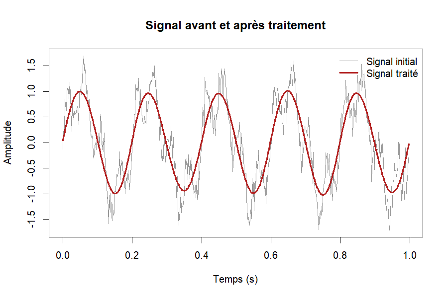
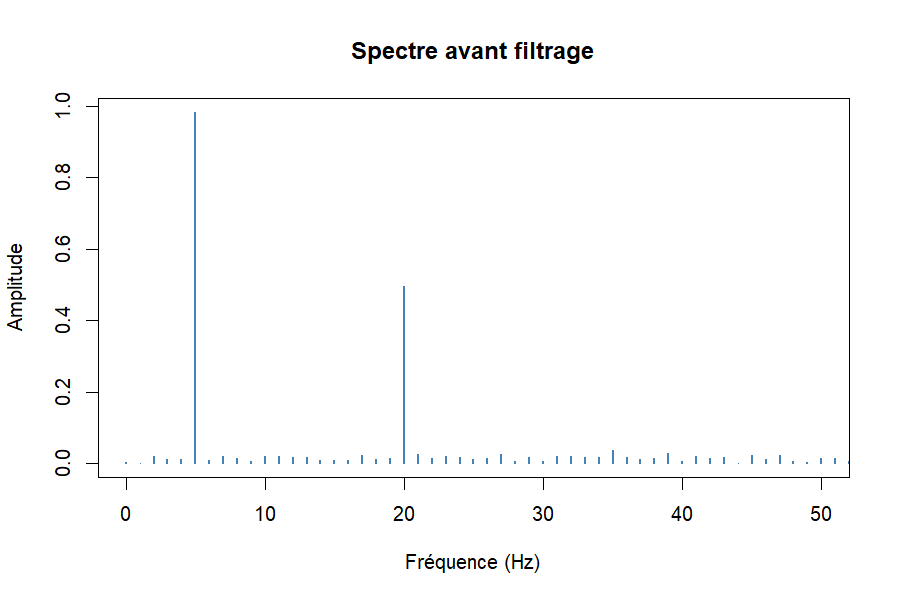
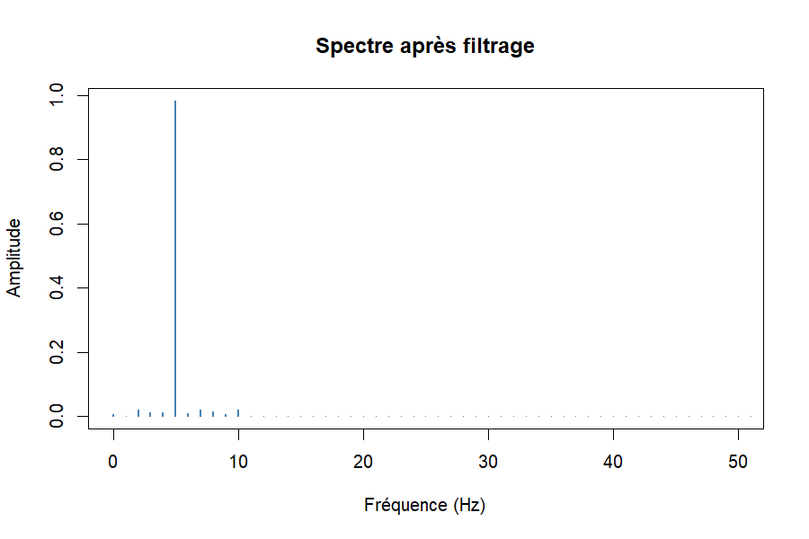
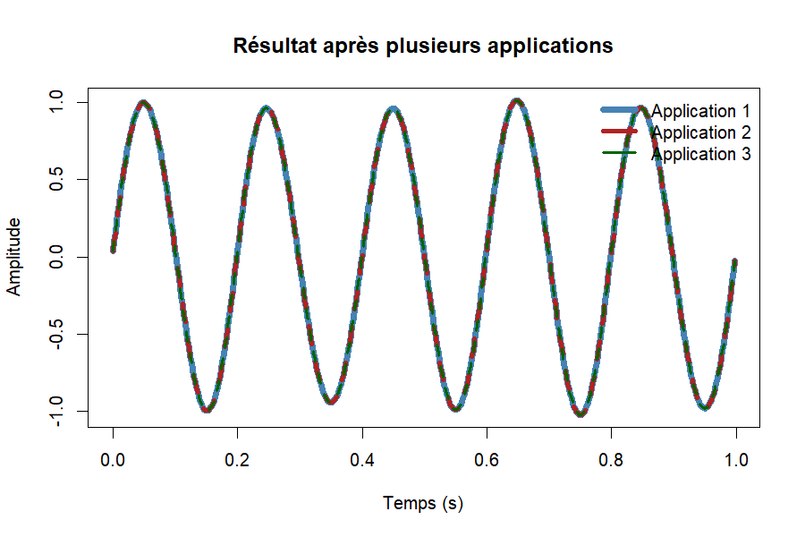

# IdemSignal

IdemSignal est un package R de traitement du signal fondé sur les
*transformations idempotentes*, c'est-à-dire des opérations dont la
répétition ne change pas le résultat : f(f(x)) = f(x).

## Le problème d'ingénierie

Le signal d'un capteur traverse plusieurs étages de traitement (filtrage,
seuillage...). Si un étage n'est pas idempotent, retraiter une donnée déjà
traitée la déforme. IdemSignal fournit des étages idempotents, *vérifie*
leur idempotence avec une tolérance chiffrée, et *trace* les résultats.

## Installation

# install.packages("remotes")
remotes::install_github("frenzojefe-bot/IdemSignal")

## Les fonctions

*Traitement du signal*

| Fonction | Rôle |
|---|---|
| creer_signal() | Génère un signal (sinusoïdes + bruit) |
| filtrer_signal() | Filtre passe-bas idéal (par transformée de Fourier) |
| seuiller_signal() | Met à 0 les valeurs de faible amplitude |
| extraire_harmonique() | Isole une composante de fréquence donnée |
| verifier_idempotence() | Vérifie f(f(x)) = f(x) et donne l'écart maximal |

*Tracés*

| Fonction | Rôle |
|---|---|
| tracer_signal() | Trace un signal |
| tracer_signal_filtre() | Compare le signal avant et après traitement |
| tracer_iterations() | Montre l'effet de plusieurs applications |
| tracer_harmoniques() | Trace chaque harmonique séparément |
| tracer_spectre() | Trace le spectre de fréquences |

## Exemple

library(IdemSignal)

s <- creer_signal(graine = 1)
y <- filtrer_signal(s$x, fs = 500, fc = 10)

tracer_signal_filtre(s, y)
verifier_idempotence(function(v) filtrer_signal(v, 500, 10), s$x)

## Le filtre supprime la composante à 20 Hz

Le signal contient deux sinusoïdes (5 Hz et 20 Hz). Après le filtre
passe-bas à 10 Hz, il ne reste que celle de 5 Hz.

## Preuve visuelle de l'idempotence

Appliquer le filtre 1, 2 ou 3 fois donne exactement la même courbe : les
trois courbes se superposent.

